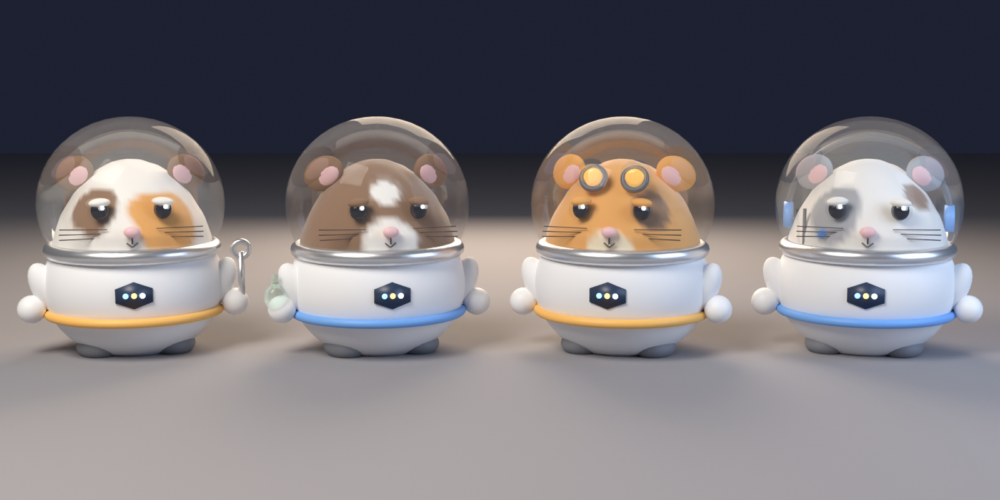

# The cuy crew (issue #44, for v0.3.0)

Four cuy astronauts (Andean guinea pigs), the protagonists of the v0.3.0 story (`docs/design/story-v0.3.0.md`).
Our own design, modelled by script in Blender (`assets/source/crew_cuy.py`): no AI image, no outside model.

| Name (proposed) | Station | Coat | Suit stripe | Prop |
|---|---|---|---|---|
| Rumi (stone) | Engineer | white, ginger and chocolate patches | sunrise amber | a wrench |
| Killa (moon) | Scientist | chocolate, white blaze | horizon blue | a flask |
| Inti (sun) | Pilot | ginger, cream muzzle | sunrise amber | goggles |
| Wayra (wind) | Ground control | white, slate patches | horizon blue | a headset |

The look: a bean-shaped body with no neck, a deadpan face (small dark eyes half under a flat lid, a pink nose, a tiny
mouth, whiskers), fur in three colours as vertex colours, a short white suit in the game's palette, and a clear bubble
helmet so the face reads. Stylized next to documentary-real craft, as `docs/design/criteria.md` allows for characters.

Names and look to be confirmed by both team members before they go into the game.
